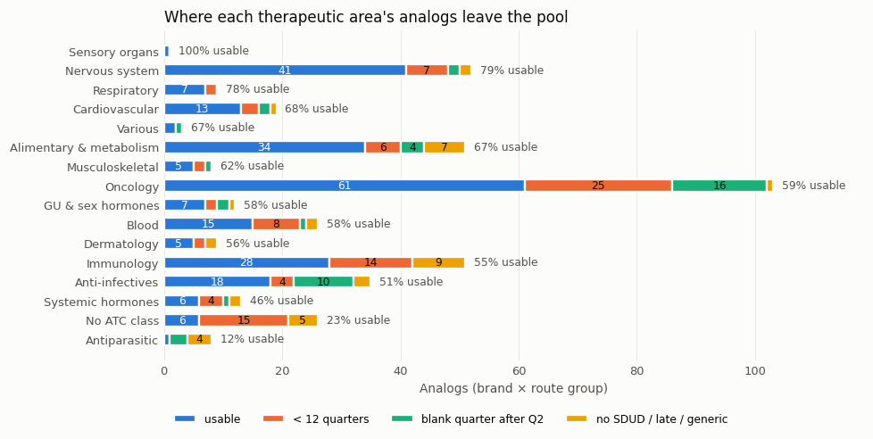
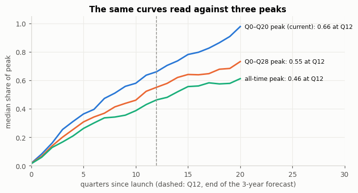
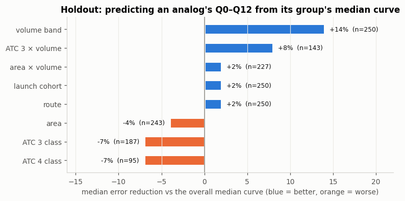

# Launch Analog Tool: EDA Findings

**Team:** Christina, Gabrielle, Joshua, Grace · **Date:** 2026-10-23 · **Data:** Medicaid prescriptions (SDUD) for novel oral and self-injected drugs approved 2010–2025

The tool helps a forecaster pick past launches ("analogs") to set two inputs for a new drug: how big it gets (the **ceiling**) and how fast it gets there (the **trajectory**, a Bass curve fitted to the analogs). The EDA checked whether our data can support that.

| Who | What they looked at |
|---|---|
| Christina | First pass: the pool, curve shapes by area, peak timing, Bass fit quality, distortion flags |
| Gabrielle | Which analogs are usable and why others drop out; gaps in the Medicaid data; late launches |
| Joshua | How Medicaid volume affects curve shape and fit quality |
| Grace | How the peak is defined and over what window; whether analog matching predicts uptake |

## 1. What data we have *(Gabrielle, Christina)*

- **250 of 426 candidate analogs are usable** (≥ 3 years of clean Medicaid data). In practice that means **2010–2021 approvals**: only 8% of 2022–25 approvals have enough quarters yet.
- **The usable pool leans towards drugs that lasted and had Medicaid volume.** Dropped analogs are tiny (median ~440 lifetime prescriptions vs ~35,000 for usable ones): drugs that faded (the first hepatitis C orals, replaced within a few years) and niche oncology or rare-disease drugs.
- **Self-injected (sc) drugs are the weakest group.** sc oncology is mostly clinic-administered bispecifics (1 of 7 usable), which our scope excludes but the data can't yet flag.

*Most losses are drugs too recent to have 3 years of data (orange) or with gaps in their Medicaid series (green).*

## 2. What launch curves look like *(Christina, Joshua)*

- **Areas differ less than expected.** Most reach half their peak in 5–8 quarters. Oncology starts faster and flattens; immunology and sc drugs start slower and catch up.
- **Medicaid volume shapes the curve.** Drugs that are small in Medicaid reach half their peak by quarter 5, large ones by quarter 9, and this isn't a noise effect.
- **About 40% of Bass fits are weak, mostly because of low Medicaid volume**, not because Bass can't follow the shape. A simulation that shrinks large curves and adds counting noise reproduces the pattern. Oncology's weak fits are largely oncology being small in Medicaid.

## 3. Where the peak really is *(Christina, Grace)*

- **43% of curves are still at their highest at the end of the 5-year window.** It isn't COVID-era Medicaid enrollment growth (curves rise just as much without it).
- **95% of those keep rising afterwards**, to a median 1.44× the 5-year peak.
- So **"how far along is a drug at year 3" depends on the peak we divide by**: about two-thirds of the way against the 5-year peak, a little over half against a 7-year peak. The Bass shape (p, q) doesn't change with the peak definition; only the fitting window moves it.

*Same analogs, same curves: the share of peak at year 3 (dashed line) falls from 0.66 to 0.55 to 0.46 as the peak is taken over a longer horizon.*

## 4. Does analog matching work? *(Grace, building on Joshua)*

- **Drugs in the same mechanism class have only slightly more similar early curves**, and predicting a held-out drug from its class's median curve is **worse** than using the median of all analogs. That holds even for a clean class like the four SGLT2 inhibitors.
- **Medicaid volume is the only structured feature that helps** (14% lower error), but a new drug's Medicaid volume isn't known before launch.
- **So class and area alone won't pick good analogs.** Line of therapy, competition and dosing (read from the original labels, still under review) will have to do the work, and the tool should show the analogs' **range**, not one borrowed curve.

*Blue = the grouping predicts better than the median of all analogs; orange = worse. Only volume helps clearly.*

## 5. Questions

1. **How should "peak" be defined for a launch forecast?** Our curves keep rising past year 5, so measuring progress against the 5-year peak overstates year-3 uptake. What horizon do forecasters use for peak (a peak year, or a fixed 7–10 years), and how do they treat growth from later indications?
2. **What makes a good analog in practice?** Mechanism class and therapeutic area barely predict early uptake in our data. What do forecasters match on: line of therapy, order of entry, competitive intensity, size of the patient population? Is showing a range of analogs, rather than one curve, standard practice?
3. **Can Medicaid curves stand in for the market?** Medicaid volume drives curve shape and fit quality, oncology is small in Medicaid, and our usable pool favors launches that lasted. How credible are Medicaid-based shapes for a commercial forecast, and what would you use to check them (Medicare Part D, IQVIA, other)?

## Next steps

- Review and approve the label reads (line of therapy, competition, dosing), so matching on them can be tested.
- Choose the therapeutic area for our example drug.
- Pipeline changes the EDA points to: peak over a fixed longer horizon, and a flag for clinic-administered drugs.
